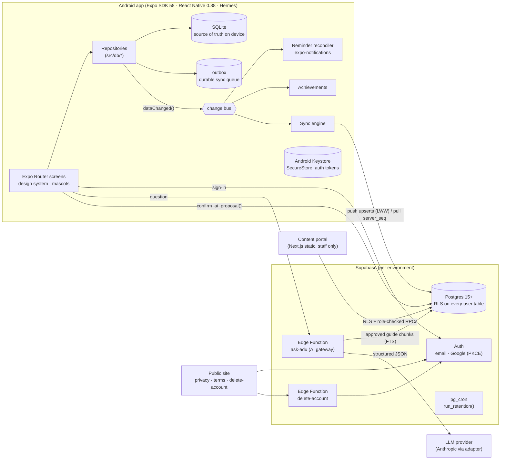

# AdultingOS architecture

## System diagram

## Key decisions

| # | Decision | Why |
|---|---|---|
| ADR-1 | **Local-first**: on-device SQLite is the source of truth; the server is a synchronized replica | Works offline and in guest mode; the UI never waits for the network; honest "saved on this device / waiting to sync / backed up" states |
| ADR-2 | **Client-generated UUIDs + deterministic ids** for occurrences (`stableUuid('occ', obligation, scheduled_date)`) and payments (`stableUuid('pay', occurrence)`) | Retries, a second device completing the same bill offline, or a guest → account upload converge on the same rows; the DB's `unique (obligation_id, scheduled_date)` and `unique (occurrence_id)` are the final guard |
| ADR-3 | **Sync**: push = upsert by id; the server trigger assigns a monotonic `server_seq`; pull = `server_seq > cursor`; conflicts = last-writer-wins on `client_updated_at` (stale writes are skipped by a trigger) | Simple, auditable, no clock-skew in cursors; per-row LWW is adequate for single-user data |
| ADR-4 | **Recurrence advances from the scheduled date**, anchored day-of-month clamped to month length | Paying late doesn't shift the schedule; a bill on the 31st falls on Feb 28/29 and returns to the 31st |
| ADR-5 | **Money as integer centavos** end to end (`bigint` in Postgres, integers in JS) | No binary floating point anywhere amounts are stored or summed |
| ADR-6 | **Reminders reconciled, not appended**: the desired set is recomputed from data and the OS schedule made to match | Deleting/completing/rescheduling cancels reminders; no duplicates; survives time-zone changes |
| ADR-7 | **AI behind a server gateway** with a provider interface; model/keys server-side; structured JSON output validated; citations come from our source table, never model text | Keys never in the APK; vendor swap without app changes; grounding is enforced in code, not just prompted |
| ADR-8 | **AI writes are proposals** confirmed through `confirm_ai_proposal()` (row lock + status check + deterministic task ids) | Exactly-once, user-approved creation |
| ADR-9 | **Content governance in the database**: guides can only be published by reviewers via `publish_guide()`, which requires a verified official source and snapshots a version | The rule can't be bypassed by a buggy client |
| ADR-10 | **Feature flags**: build-time defaults; only non-safety flags can be switched on remotely | Unreleased modules and unverified-guide preview can never leak into production remotely |

## Data flow: completing a recurring bill

1. `markBillPaid(occ, paidOn, amount)` — in one SQLite transaction: upsert payment `stableUuid('pay', occ)`, set occurrence amount.
2. `completeOccurrence(occ)` — transaction: mark done (no-op if already done); compute `nextDueDate(rule, scheduled_date)`; insert next occurrence with `stableUuid('occ', obligation, next)` unless one exists for that date.
3. All rows go to the outbox in the same transaction → change bus → reminders reconciled, achievements evaluated, sync debounced (2 s).
4. Sync pushes parents before children; server triggers enforce ownership and LWW; RLS enforces isolation.

## Ask Adu request path

`ask-adu` Edge Function: authenticate → validate (≤1000 chars) → consent check (`has_consent`) → daily quota → redact long numbers → `search_knowledge()` (published chunks only) → optional minimal records (titles + due dates, only with `ai_record_access` consent **and** a schedule-type question) → model call with JSON schema → zod validation → `finalizeAnswer()` (citations limited to supplied excerpts; uncited "verified" downgraded; uncertainty note for government questions; credential-phishing filter) → store messages + proposal (service role) → audit event (no content) → response. Failures return typed errors; the app never fabricates an answer.

## Repository layout

See the root README. Business logic lives in `packages/shared` (pure, unit-tested); data access in `apps/mobile/src/db`; infrastructure (sync, auth, notifications) in `apps/mobile/src/sync` and `src/notifications`; UI in `src/ui` and routes in `src/app`.
