# Database: ERD and data dictionary

Source of truth: `supabase/migrations/*.sql`. Every table in `public` has RLS enabled. Personal tables reference
`auth.users(id) ON DELETE CASCADE`, so deleting the auth user deletes their data.

## Entity relationship diagram (core)

```mermaid
erDiagram
  AUTH_USERS ||--|| PROFILES : has
  AUTH_USERS ||--|| USER_PREFERENCES : has
  AUTH_USERS ||--|| NOTIFICATION_PREFERENCES : has
  AUTH_USERS ||--o{ CONSENT_RECORDS : gives
  AUTH_USERS ||--o{ OBLIGATIONS : owns
  OBLIGATIONS ||--o{ OBLIGATION_OCCURRENCES : "has instances"
  OBLIGATIONS ||--o{ TASK_CHECKLIST_ITEMS : has
  OBLIGATIONS ||--o| BILLS : "is a (kind=bill)"
  OBLIGATIONS ||--o| SUBSCRIPTIONS : "is a (kind=subscription)"
  BILLS ||--o{ BILL_PAYMENTS : records
  OBLIGATION_OCCURRENCES ||--o| BILL_PAYMENTS : "paid by (unique)"
  AUTH_USERS ||--o{ DOCUMENTS : owns
  DOCUMENTS ||--o{ DOCUMENT_RENEWALS : history
  AUTH_USERS ||--o{ CATEGORIES : "custom"
  AUTH_USERS ||--o{ USER_ACHIEVEMENTS : unlocks
  ACHIEVEMENTS ||--o{ USER_ACHIEVEMENTS : ""
  AUTH_USERS ||--o{ AI_CONVERSATIONS : has
  AI_CONVERSATIONS ||--o{ AI_MESSAGES : contains
  AI_MESSAGES ||--o| AI_ACTION_PROPOSALS : proposes
  AI_MESSAGES ||--o{ AI_CONTENT_REPORTS : "reported in"
  GUIDES ||--o{ GUIDE_STEPS : has
  GUIDES ||--o{ GUIDE_REQUIREMENTS : has
  GUIDES ||--o{ GUIDE_SOURCES : "cites (audited)"
  GUIDES ||--o{ GUIDE_VERSIONS : "published snapshots"
  GUIDES ||--o{ KNOWLEDGE_CHUNKS : "retrieval index"
  GUIDES ||--o{ CONTENT_REPORTS : "reported in"
  AUTH_USERS ||--o| ADMIN_ROLES : "staff only"
```

## Sync columns (all syncable tables)

| Column | Type | Meaning |
|---|---|---|
| `id` | uuid | Client-generated (v4) or deterministic (v8 `stableUuid`) |
| `user_id` | uuid | Owner; immutable (trigger) |
| `created_at` | timestamptz | Preserved across updates |
| `updated_at` | timestamptz | Server time of last accepted write |
| `client_updated_at` | timestamptz | Device time of edit; stale writes (older than stored) are skipped |
| `deleted_at` | timestamptz | Tombstone; purged after 90 days by `run_retention()` |
| `server_seq` | bigint | Monotonic per write (`sync_seq`); pull cursor |

## Tables

| Table | Purpose | Notable constraints |
|---|---|---|
| `profiles` | Preferred name, country, language, time zone, optional employment/living, favorite mascot | id = auth user; no sensitive fields |
| `user_preferences` | Theme, reduced motion, mascot visibility, gamification, AI record access | |
| `notification_preferences` | Categories, reminder time, quiet hours, weekly summary, lock-screen details | |
| `user_devices` | Push tokens (future remote push) | unique (user, token) |
| `consent_records` | Append-only consent history (terms, privacy, ai_processing, ai_record_access, analytics) | no update/delete policy |
| `account_deletion_requests` | Proof of deletion without identity | user_id → NULL on delete |
| `categories` | Custom task categories | |
| `obligations` | Definition of a task/bill/subscription: title, category, priority, due time, recurrence (jsonb), reminder offsets, tags, notes, source | recurrence.freq enum; lengths |
| `obligation_occurrences` | Concrete instances: scheduled_date (immutable), due_date (reschedulable), status, completed_on, amount_minor | **unique (obligation_id, scheduled_date)**; done ⇔ completed_on |
| `task_checklist_items` | Subtasks | same-owner trigger |
| `reminders` | Server push queue (weekly summary/future) | per-item reminders are on-device |
| `documents` | Document metadata: template, issuer, stage, issue/expiry dates, `reference_last4`, reminder offsets | reference ≤ 4 alnum chars; issue ≤ expiry; https URLs |
| `document_renewals` | Previous and new dates per renewal | |
| `bills` | Provider, bill category, amount (centavos, nullable for variable), currency | one per obligation |
| `bill_payments` | Paid on, amount, currency | **unique (occurrence_id)** |
| `subscriptions` | Category, amount, currency, trial end, status, canceled_on | |
| `guides`, `guide_steps`, `guide_requirements`, `guide_sources`, `guide_versions`, `knowledge_chunks` | Curated content, sources stored separately, version snapshots, FTS index | publish only via `publish_guide()` |
| `content_reports`, `ai_content_reports`, `feedback_reports` | User reports | staff read via role; user_id → NULL on delete |
| `ai_conversations`, `ai_messages`, `ai_action_proposals` | Ask Adu history and proposals | users read/delete only; writes by gateway (service role); **no staff policy** |
| `mascots`, `achievements`, `user_achievements`, `user_mascots` | Gamification | unique (user, achievement) |
| `notification_logs`, `audit_events`, `feature_flags`, `admin_roles` | Operations | audit readable by super admin only |
| Phase 4: `savings_goals`, `savings_contributions`, `life_event_templates`, `user_life_events`, `life_event_tasks`, `households`, `household_members`, `household_tasks`, `grocery_lists`, `grocery_items`, `routines`, `routine_completions` | Created with RLS; app screens disabled by flags | household data visible to members only; private records never shared |

## Functions

| Function | Security | Purpose |
|---|---|---|
| `confirm_ai_proposal(id, selected[], due_dates)` | definer, owner-checked, row lock | Exactly-once task creation from AI proposals |
| `cancel_ai_proposal(id)` | definer | |
| `set_guide_status(id, status)` / `publish_guide(id)` | definer, role-checked | Content workflow (publish requires verified official source) |
| `search_knowledge(query, limit)` | invoker | FTS over published chunks |
| `export_my_data()` | invoker (RLS-scoped) | JSON export of caller's rows |
| `delete_my_ai_history()` | invoker | |
| `admin_usage_summary()` | definer, staff-only | Aggregate counts only |
| `has_consent(user, type)`, `ai_messages_today(user)` | definer | Gateway checks |
| `run_retention()` | definer, not granted to clients | Tombstones, AI history (12 months), logs |
